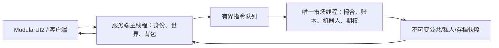

# 01-realistic 实施计划

状态：实施中；撮合/账本/工作线程基础已开始，尚未接入游戏。基线 `c0323f3`，2026-11-09。需求来源：[spec.md](spec.md)；开发约束：[AGENTS.md](../../AGENTS.md)；执行记录：[tasks.md](tasks.md)。本文类型/路径中尚不存在的名称均为建议，不代表现有接口。

## 1. 范围与复用

交付范围对应 spec §2–14：单市场线程、订单簿、五类错峰机器人、净仓位账户、保护单、真实成交图表、欧式期权及 Delta 对冲。无外部服务、数据库或新 UI 框架；保留钱包兑换与 GTNH 联动。先打通基础市场到玩家 UI 的闭环，再完成期权，分阶段并不删除最终期权范围。

现有可复用能力：生命周期与登录/tick 钩子；long 分与舍入工具；配置注册；UUID 钱包和世界存档；ModularUI2 操作同步；行情公共缓存；终端/世界屏幕共享渲染；中英文资源。现有逐笔 Position、无影线 Candle、float 价格文件和两个行情消息不能直接充当新模型，必须有适配或迁移边界。

## 2. 需要收敛的设计决策

以下为原稿留白的建议默认方案，非额外用户确认的产品要求。实施 P0 时核对并记录最终结果；涉及资产损失或语义冲突的方案不能自动执行。

| ID | 建议与理由 | 验证 / 未决边界 |
| --- | --- | --- |
| D01 旧世界（用户已决定） | 不兼容更新，清空旧交易/持仓/行情记录，仅保留净值：旧钱包现金 + 各旧仓保证金 + 按最后有效价格计算的未实现盈亏；保留玩法配置 | 新净值与一次性标记持久化成功后再清旧记录；无有效价格/溢出中止迁移，不重复收费，不保留旧模式。净值计算已加回归，持久化接线待做 |
| D02 会计（固定保证金率已获用户确认） | 复用 long 分作为唯一现金账本。用户已选择按合约数量下单、品种固定保证金率，移除自选杠杆滑条。新模式采用净仓、现金不含未实现盈亏，保证金为占用而非重复扣减本金 | 明确 cash、equity、usedMargin、frozen、available、optionValue 的恒等式；旧“先扣保证金”账法只能经一次迁移转换，不可混用 |
| D03 精度 | 订单价格 long tick、数量 long 整数、tickValueCents 和合约乘数显式配置；浮点只用于模型与展示 | 乘数/金额单位必须有精确转换与溢出拒绝；不得用 float 历史恢复新现金账本，未对齐价格拒绝而不静默改价 |
| D04 时钟 | 单调运行时用于调度，主线程累计服务器有效游戏 tick 用于期权，默认一天 24000 tick、一年 365 天 | 暂停/卸载停止推进；睡觉与 /time 不跳到期，停服不补跑；快照含 tick 与事件序号，跨重启保存累计 tick |
| D05 撮合 | 成交使用被动挂单价；同价按市场接收序号 FIFO；遇本账户对手单取消主动剩余量，避免自成交 | 限价剩余 GTC、市价剩余 IOC；所有玩家、机器人、对冲遵守同一规则。自成交策略可调整，但必须固定并可测试 |
| D06 资金与风险 | 限价开仓冻结最坏限价所需保证金及费用；市价开仓有最大滑点/价格保护预算，逐笔填单后释放差额 | 反手先减少旧仓，再为超出部分检查新开仓资金；reduceOnly 不得变新开仓。费用、库存限制同样适用于机器人；不得无限授信伪造流动性 |
| D07 标记价 | 最近有效成交作为基础标记；期权/对冲用有界平滑参考价；到期前成交窗口均价，无成交回退最后有效价 | 确定窗口长度、无初始成交的不可交易状态、强平触发参考；不以隐藏公允价伪造成交或结算价 |
| D08 报价确认 | 期权购买请求包含 quoteId、期限、数量和最大可接受总价；市场线程按有效报价重新检查 | 超时或超价拒绝并返回新报价；不得悄悄按明显更高报价扣款。纯买入期权不占额外玩家保证金 |
| D09 保存/兑换 | 单写者导出带版本快照，由主线程通过 NBT 桥原子写入世界目录；跨 MC 背包的兑换以 transferId、托管记录和幂等确认交接 | 必须设计保存屏障及恢复核对；出现未完成转账时冻结相关额度待对账，不能再次发物品或重复入账。实施前验证存档顺序能满足故障恢复 |
| D10 缺流动性 | 无对手盘的市价剩余取消；强平部分成交后保持待减仓并有界重试；流动性保障仅由之后的独立事件有限补单 | 不允许一次吃单过程中无限补单，也不得直接改价格/现金假装强平成交；债务规则与旧钱包保持兼容 |

D02 拟定公式（待 P0 用样例固定）：`equity = cash + underlyingUPnL + optionValue`；`available = cash + underlyingUPnL - usedMargin - frozen`，期权估值不作为可提取或新增开仓抵押。钱包提现还需保证提现后维持风险约束，不能直接把 equity 当现金。已实现盈亏、手续费、期权权利金及到期收入分别记账，保证金释放不计利润。示例 initialMarginRate/commissionRate 与当前杠杆及百分比配置须显式换算，不直接复制 TOML 数值。

## 3. 目标职责与线程边界



- 在 `market/server/` 演进 `MarketService` 为生命周期协调者。市场线程持有普通 Java 对象，不持有 EntityPlayer、World、ItemStack、MapStorage 或可变 NBT。
- 新增领域代码优先按 `market/order/`、`market/bot/`、`market/time/`、`options/` 等职责组织；复用 `trading/`、`wallet/`，不一次重写全仓。最终类名由实现决定。
- 将当前 `TradingService` 和 `WalletService` 的同步调用改为排队命令/结果适配；查询使用不可变快照。迁移前后均只有一个账户写入者。
- 每条命令携带服务端确认的 UUID、requestId、会话/世界 generation；限长限量、队列满返回 BUSY，重复请求重放原结果。世界切换后拒绝旧结果。
- 每轮优先处理玩家指令，但玩家指令也有预算，机器人/到期/风控不会被持续洪泛饿死；普通机器人事件设置独立预算。内部事件用到期时间加序号排序，单轮多个成交保持顺序，不合并成一次价格跳跃。
- 使用一个调度执行器；防止 fixed-rate 超时追赶形成洪峰。暂停冻结市场逻辑时间，恢复时重基准运行时 deadline；重启不恢复失效的 nanoTime 绝对值。随机流按全局种子及稳定实例 ID 拆分。
- 保存时在命令序列中设置屏障，获取一致深拷贝后主线程落盘；主线程不持 MC 锁等待仍需其回调的任务。停止时停止接单、处理/拒绝尾部队列、快照保存、关闭线程并等待退出，超时报告，禁止后台继续写世界。

## 4. 领域实现要点

### 撮合、净仓与风控

订单有账户、品种、方向、数量/剩余、类型、限价、reduceOnly、状态、编号及接收序号。每笔成交产生不可重复的 fillId，原子更新双边订单、现金/占用、净仓、费用、历史及公共行情。价格优先、FIFO、撤单和部分成交必须先有小型确定性回归。

新净仓按账户+品种聚合，保存有符号数量、成本、已实现盈亏；同向加仓加权，反向先平再开。不要用旧 Position 的杠杆盈亏公式直接给新的合约数量再乘一遍杠杆。按初始/维持保证金规则及最大仓位限制处理新增风险；亏损仍可形成债务。

止损由成交触发生成 reduceOnly 市价单，止盈为 reduceOnly 限价单。OCO 在市场线程按每次成交重算共同可平数量；手动平仓、部分成交、撤单、强平和反手都清理失效保护，不允许重复冻结同一可平仓数量。

### 机器人与行情

五类机器人及其作用完整保留：做市商逐档维护深度，趋势跟随动量，均值回归参考均价，噪声提供小额活动，巨鲸低频吃多档。均使用公共下单入口、独立随机流和库存/资金上限；初始偏移、抖动、随机跳过、随机数量可配置，截断对数正态作为可选扩展。

隐藏公允价、漂移与有界衰减订单流影响仅指导策略。只有成交更新 lastPrice/volume/trade tape。成交按市场时间桶聚合 OHLCV，无成交桶沿用前收且量为零；没有任何成交前标明无成交参考，不能写出伪成交。记录补单恢复与大额冲击的观察数据，不能以“保证无法套利”替代可验证指标。

### 期权及对冲

默认每 2 个游戏日生成系列，固定到期日、执行价、乘数，期限 336000 个累计游戏 tick；仅买入欧式 Call/Put，无提前出售/行权、无期权订单簿。BS 使用游戏年单位、r=0，处理 T=0、sigma=0、极端 S/K、NaN 与单位舍入；IV 与报价平滑、有界，模型可 double，最终现金回到 long 分。

购买原子扣权利金并记成本。到期价格冻结在合约 expiryTick 对应窗口，处理延迟不得使用到期后的成交；窗口无成交使用到期时已知最后有效价。以 contractId/positionId/settlementId 幂等结算，离线玩家也结算，存档恢复不得重复付款。

按玩家期权净 Delta 聚合系统目标对冲，减去实际已成交对冲仓位和有效在途订单，避免重复下完整目标量。每标的独立随机事件，按批次/频率/库存/风险预算限量，通过同一标的订单簿撮合；部分成交、撤单和到期后退出均更新实际敞口。

## 5. 数据、网络与 UI 对接

- 保留旧钱包 NBT 读取及价格文件，不原地解释为新格式。新市场存档带 schemaVersion、generation、累计游戏 tick、订单/成交/结算编号、账户、冻结记录、净仓、活动单、OCO、合约、期权仓及对冲状态；机器人状态可保存或安全重建，选择需记录。
- 恢复顺序：读版本/校验 → 一次迁移 → 重建冻结与索引 → 对账兑换/结算 → 恢复活动订单和调度 → 开始接单。无法安全恢复时禁用该市场并输出可操作错误，不归零玩家资产。
- 扩展 `StockSnapshot/PriceUpdate/StockView/Candle` 或新增版本化消息承载 OHLCV、盘口深度、成交序列。重连发公共全量，之后发有界增量；客户端发现序号缺口请求重同步。
- 私人账户、订单、期权和标记仅发给本人；世界屏幕只消费公共行情。消息有版本、数量上限及权限检查；服务端推送结果含 requestId/status/fills/reason，不再只靠余额变化暗示成功。
- `ItemMarketTerminal` 保留灰色像素风和左图右表布局，在现有框架增加账户、订单/成交、期权区域；保留钱包、快速数量、滚动和持仓操作。适度提取子组件，避免新增巨型 Item 类或重建 UI 框架。
- `StockPanelRenderer` 继续共享公共图表绘制；私人叠层由终端调用方提供，世界屏不接收。绘制影线、量、价格线与成交时间映射，限制可见窗口内标记数；成交/撤单/平仓后及时移除。
- GTNHLib cfg 管理全局参数，新品种定义增加 tick/乘数/风险与机器人字段；仅明确兼容的行为参数可动态生效。tickValue/乘数等有活动资产时不允许直接热改。网页配置器明确区分旧公式预览与新市场配置，不能保留误导性的模拟一致性承诺。

## 6. 分阶段与交付门槛

| 阶段 | spec 范围 | 可审阅结果 / 出口 |
| --- | --- | --- |
| P0 对接冻结 | §1–2、8、14 | D01–D10 收敛；精度/会计样例、迁移与保存协议明确 |
| P1 核心 | §2、6、8 | 单写者、撮合/净仓/冻结纯逻辑闭环，确定性回归通过 |
| P2 市场生态 | §3–5 | 五类机器人错峰、成交驱动 OHLCV，大额冲击与有限恢复可观察 |
| P3 玩家闭环 | §7–8、14 | 真实玩家命令、钱包交接、OCO、平仓/反手、保存重启正确 |
| P4 UI | §9、13 | 盘口、订单/持仓/成交、结果反馈可操作，公共屏无私密泄漏 |
| P5 期权 | §10 | 系列/报价/购买/估值/幂等现金结算及界面 |
| P6 对冲 | §11 | 随机分批对冲真实入簿，实际仓位与在途量准确 |
| P7 整体验收 | §12、14–17 | 配置、多人、保存/暂停/卸载、性能预算、原稿 13 项验收及文档 |

P1 起即建立必要存档和快照接口，不能等到最后才发现线程与 WorldSavedData 不兼容。每阶段保持可以构建；未完成模块明确关闭/标注，不用假数据填满 UI。

## 7. 验证和状态维护

沿用 AGENTS.md 工具链：Java 25 daemon、Java 17 Jabel、Java 8 游戏运行；现代 JDK 示例（例如有界 nextLong）需改为 Java 8 可用实现。

```bash
source /workspace/.cloud-setup/env.sh # 仅在该环境脚本存在时
bash gradlew --build-cache --console=plain setupCIWorkspace
bash gradlew --build-cache --console=plain assemble
bash gradlew --build-cache --console=plain build
bash gradlew --build-cache --console=plain runServer
```

选择项目兼容的轻量测试设施；针对撮合、会计、调度、OCO、到期、恢复写确定性回归，不引入庞大压测工程。每阶段记录真实通过/失败/NO-SOURCE/未执行，不能把旧基线的成功当成本功能验收。多人操作、图形 UI 和期权快进验证需实际运行；不能通过主机睡眠 14 天验证游戏 tick。

tasks.md 的 V01–V13 对应原稿最低验收；额外 R01–R05 针对跨线程/资产风险。仅勾选有证据的条目。实施每阶段后更新 tasks、相关规格决策和 AGENTS.md 的事实；已开始纯 Java 核心实现；游戏入口和验收状态以 tasks.md 为准。

## 实施补充（2026-11-09）

MapStorage.saveAllData 会吞写盘异常且直接覆写文件，因此采用 RealisticSavedData 作为 NBT 序列化桥，由 AtomicMarketStore 执行强制刷盘与原子替换；不将同一快照文件再交给 MapStorage 自动覆盖。未支持原子替换时拒绝迁移。账本手续费使用 ppm（550 = 0.055%），保证金使用 bps（1000 = 10%），避免把旧 0.055% 费率误取整为 0.06%。开发开关暂默认关闭，尚未开放不完整的游戏接线。

## 最新交付范围调整

用户在实现过程中要求停止反复测试，优先快速交付原型，集中最后一轮验证后等待人工反馈。先交付已接线的撮合、机器人、净仓、钱包兑换、保护单、OHLCV 和简化期权/对冲闭环；原稿仍作为后续目标，高级图表标记、精确到期逐笔窗口、历史归档、全面配置与完整多人/客户端回归不宣称完成。新市场默认开启并采用用户确认的净值迁移；首次体验应在世界副本进行。

## 2026-11-10 用户人工反馈对接

用户要求本轮改进 UI 后重新构建并提交 Git：深色彩色交易终端、红绿盈亏、放大 K 线并小范围拖动、私人持仓/止盈止损/挂单横线；提高默认波动；切到限价时取即时价，市价不显示价格框；保护单支持价格与指定保护数量的盈亏金额互算。钱包复用原截图的 WalletGui 布局与图标/存入槽/背包，资金接入同一新账本。期权改为 Call / 执行价 / Put 的 T 字报价，1–14 游戏日到期标签选择，服务器每日补齐到期梯队，旧合约保持原到期日。此用户确认取代此前单一 14 日到期、每 2 日一批及仅直接背包兑换的原型交互；long 分、整数 tick、服务端权威与单线程撮合不变。

已实现范围及本轮实际验证见 `PROTOTYPE.md`；仅进行一轮集中验证和必要失败修正，交付后等待人工反馈。未完成的完整规格验收仍保留，不因界面更新整体勾选。

后续同轮确认：用户要求提前行权和平仓，替换“仅到期欧式”交互，采用可部分提前现金行权（内在价值）与做市商 bid 回购，剩余份额保留到期结算；现有 r=0/无分红 BS 模型保留。用户报告全部平仓只成交 8 张，现改为持久化 reduceOnly 平仓意图，在真实流动性补充后重试余量；主 UI 改用固定容器与独立滚动列表，处理期权滚动串入交易页。最终 build/35 项回归通过；视觉交互待人工复核。

## 2026-11-10 追加：滚动公允价与机构规模

用户反馈 K 线消失与走势过于震荡，要求持续趋势、回归和突破；进一步指定公允价为一段时间成交均价加扰动，机构提高资本并进行数千张交换、盘口足够厚。当前实现采用默认 60 秒真实成交 VWAP（桶窗口）加平滑扰动，机构在阶段预期/库存/真实流量影响下报出实际买卖单。阶段只驱动机构行为，末价和 OHLCV 始终来自撮合。默认阶段 30–75 秒、机构资本和基础委托各放大 100 倍、机构限额 10 万张，玩家限额不变；资本增量与权限持久化，重启不重复发放。修复嵌套 Flow 中图表高度退回默认 18 像素的问题。

完整 build 与 41 项回归通过；具体参数、兼容过渡、撮合样本与实际验证范围见 PROTOTYPE.md。K 线缩放/绘制仍待真人客户端验收，不整体勾选原规格验收。

### 最新用户交付约束（2026-11-10）

在用户 `7f1bb11` 上保留 Markdown/README、GUI 与独立基本价值修改，不 reset。先用 Python 验证状态转换、模型恢复及配置归一化，再接入 Java；本轮只 `spotlessApply assemble`，不运行 Java 测试或 Minecraft。配置错误只暂停市场，不应阻断世界或重置资产。Python 16×30 分钟、616 次切换/六状态通过，构建通过；具体崩溃未拿到完整堆栈，进世界由用户最终验证。详见 PROTOTYPE.md 和 ../../docs/REALISTIC_CONFIG.md。

### 用户追加：条件式游戏内通知（2026-11-10）

止损首次触发、止盈首次真实成交、期权到期实际结算生成私人声音与 Forge 浮窗；仅在未打开终端、其他页面/品种/期限时显示。对应品种交易页静默确认保护单提醒，对应期权临期页静默确认到期提醒；切到对应页面后不补弹。加入有界、保存恢复、会话隔离和确认去重，避免重试刷屏；实际游戏验收仍由用户完成，本轮仅编译打包。细节与产物见 PROTOTYPE.md。

### 用户追加：减少插针并保留波动（2026-11-10）

机构库存报价改为有界偏移并平滑共同报价参考，清理过期机器人委托，机器人主动单采用价格/吃单比例保护。按用户要求默认每类两个参数不同实例、做市挂单量额外10倍、挂单基础间隔乘0.4、巨鲸单次上限5000（含突破放大）；趋势/突破参数保留，报价跟随120bps/秒，不裁剪K线高低价或撤玩家单。Python撮合对照4×10分钟异常长影线102→0，实体幅度仍保留；随后仅编译打包成功，未执行Java/MC测试，待用户实际验证。详情与产物见 PROTOTYPE.md。

最新通知决定：使用 GTNH AE 合成完成同款通知队列与声音，取消终端/页面/品种/期限抑制，所有事件均通知；仅编译打包，游戏体验由用户确认。

最新行情决定：做市倍率由10改为3（旧默认10在内存迁移），保留补单频率；趋势缓入缓出并加入持续短期扰动，平滑方向信号和小额报价溢价，突破推进窗口延长，阶段幅度保留。本次不运行模拟或Java/MC测试，仅编译打包。旧Python对照不代表当前版本。

最终确认：撤销 c877373，恢复62d6d3c作为最终算法（含做市3倍、五类双实例、巨鲸单次5000张限制，不保留仓位1/3）。图表用独立逐笔OHLCV展示15秒线，内部策略/VWAP/期权结算桶保持原样。长影线远端淡化，保留真实高低价、坐标轴和正常影线。旧存档原内部历史保留，新显示历史从后续成交累积并持久化。本次仅编译打包，不运行模拟或Java/MC测试。

余额/杠杆追加：旧钱包迁移优先直接读取 data/nhkantan_wallets.dat 的 NBT data 包装（也兼容直接根标签），BalancesCents 按分、旧 Balances 按整币换算，未知结构/非法UUID或非数值拒绝迁移，防止静默清零。清理前保留 legacy-backup 钱包/持仓文件及首次历史目录。已迁移世界继续读取 realistic.dat，不用旧钱包覆盖当前账户，玩家UUID必须保持一致。 UI展示实际合约等效杠杆；保证金率可配置，最低10bps=0.1%（理论1000倍），默认10%不变，重启时对旧世界重新应用。用户不要求代为恢复资金；仅编译打包，未运行Java/MC测试，未复现玩家具体问题。

千倍交易配套修复：默认 initialMarginBps=10（0.1%）、maintenanceMarginBps=5、maxPosition=10000000；可配置玩家限仓范围1–1000000000。limitsConfigVersion=0时，仅将旧默认1000/500/1000分别迁移为10/5/10000000，写入版本1并通过GTNHLib保存配置，之后不再覆盖自定义值。旧世界在恢复订单前同时应用保证金率和玩家限仓，机构限仓不变。UI区分账户实际杠杆、品种理论杠杆、每品种限仓；拒单区分限仓、资金不足、减仓数量、参数、计算范围、无对手盘。理论1000倍仍受手续费、整数分取整、卖单按价格上界预留、可用资金和有限盘口约束，不能保证每笔达到1000倍或全部成交。 本次仅编译打包，未运行模拟或Java/MC测试，不调整行情算法。产物build/libs/nhkantan-1000x-fix.jar。

强平通知：marginCycle在保证金不足时为每个玩家/品种首次强平触发创建LIQUIDATION_TRIGGERED私人事件，进入既有AE浮窗与声音通道，不按页面抑制。目标数量与触发参考价不代表已经全部成交。连续强平/部分成交重试不重复刷屏；去重状态随检查点保存，风险恢复或空仓后复位，之后新风险可再次提醒；机器人不写玩家通知。枚举追加到末尾，保留旧事件序号。 仅编译打包，未运行Java/MC测试，产物build/libs/nhkantan-liquidation-notify.jar。

修复ExchangeGui共享buildUI中的客户端翻译泄漏：标题、通用按钮、期权期限标签改用IKey.comp组合延迟语言键，不提前调用LangKey.get；需要产出String的动态文字统一使用Minecraft公共侧StatCollector，避开ModularUI的ClientScreenHandler.getTicks缓存。buildUI仍在两端构建同步结构，createScreen保留客户端隔离。只做spotlessApply/checkstyleMain/assemble，不运行测试或MC，未以真实专用服务器复现验收；不改行情、账户或同步协议。 产物build/libs/nhkantan-server-gui-fix.jar。
